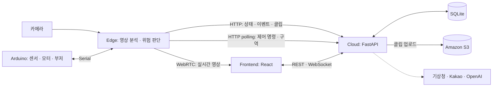

# BARO · Conveyor Guard

**현장의 위험을 감지하고, 컨베이어 제어와 사고 기록으로 연결하는 산업 안전 프로젝트.**

BARO는 컨베이어 주변 작업자의 위험구역 진입과 낙상을 카메라 영상으로 감지하고, 현장 장치에서 감속·정지·경보를 실행하는 시스템입니다. 웹 대시보드에서는 실시간 영상과 설비 상태를 확인하고, 위험구역을 설정하며, 이벤트 이력과 안전점수를 조회할 수 있습니다.

우리는 **감지 → 판단 → 대응 → 기록**을 하나의 흐름으로 연결하는 데 집중했습니다. 영상 분석과 설비 제어는 현장의 Edge가 맡고, Cloud는 인증·이력·운영 데이터를 관리하며, Frontend는 관리자가 상황을 이해하고 조작하는 인터페이스를 제공합니다.

## 프로젝트 소개 영상

[](https://www.youtube.com/watch?v=2WTDW4HqQLo)

썸네일을 클릭하면 YouTube에서 소개 영상을 볼 수 있습니다.

**[소개 영상 보기](https://www.youtube.com/watch?v=2WTDW4HqQLo)**

## 해결하려는 문제

컨베이어 주변에서는 작업자의 접근, 낙상, 정비 중 진입처럼 서로 다른 상황에 서로 다른 대응이 필요합니다. 영상을 보여주는 것만으로는 감속이나 정지가 이루어지지 않고, 센서가 설비를 멈추더라도 당시 상황을 설명할 기록이 부족할 수 있습니다.

BARO는 영상 기반 판단과 하드웨어 신호를 운전 상태에 맞는 제어 규칙으로 연결합니다. 위험 이벤트가 발생하면 로그와 전후 영상 클립을 남겨, 관리자가 실시간 대응과 이후 상황 확인을 같은 시스템에서 수행하도록 설계했습니다.

## 주요 기능

| 기능 | 구현 내용 |
| --- | --- |
| 작업자·위험구역 감지 | YOLOv8으로 사람을 탐지하고, 웹에서 지정한 다각형 위험구역과의 겹침을 검사합니다. |
| 낙상 판단 | YOLOv8 Pose의 관절 좌표 시퀀스를 DDNet에 입력하고, 몸체 박스의 가로·세로 비율을 추가 확인합니다. |
| 현장 제어 | 운전 모드와 위험 요인에 따라 컨베이어 감속·정지, 부저 경보, 시스템 잠금을 수행합니다. |
| 운영 대시보드 | WebRTC 실시간 영상, 장치 선택, 위험구역 편집, 운전 모드 전환, 정지·리셋, 시험 속도 설정을 제공합니다. |
| 이벤트 기록 | Edge의 상태와 이벤트를 Cloud에 저장하고 WebSocket으로 화면을 갱신합니다. |
| 사고 영상 | 경고 수준 이상의 이벤트에 전후 클립을 생성해 S3에 업로드합니다. 현재 화면의 영상 재생 버튼은 낙상 이벤트에 제공됩니다. |
| 안전 리포트 | 이벤트 감점과 현장 위험도를 바탕으로 일별 안전점수, 리포트, 통계 화면을 제공합니다. |
| 선택 연동 | 기상청 관측 데이터, Kakao 주소 검색, OpenAI 기반 안전 상황 요약·권고를 연동할 수 있습니다. |

### 상황별 대응

| 상황 | Edge의 대응 |
| --- | --- |
| 자동 운전 중 위험구역 진입 | 컨베이어 속도를 50%로 낮추고 경보를 울립니다. |
| 자동 운전 중 위험구역 해제 | 시스템이 잠겨 있지 않으면 정상 속도로 복귀합니다. |
| 낙상 또는 하드웨어 비상 신호 | 컨베이어를 정지하고 시스템을 잠그며, 위험 이벤트를 기록합니다. |
| 정비 모드 | 컨베이어 전원을 차단하고, 위험구역 진입 시 경보를 울립니다. |
| 시험 운전 | 지정한 속도로 구동합니다. 이 모드에서는 영상 기반 위험 판단을 건너뜁니다. |
| 리셋 | 잠금을 해제한 뒤 정지 상태를 유지합니다. |

## 시스템 구조



### 역할을 나눈 이유

- **Edge:** 카메라 입력부터 위험 판단과 제어까지 현장 프로세스에서 처리합니다. Cloud API의 왕복 응답을 기다리지 않고 감지 결과를 제어 규칙에 전달합니다.
- **Cloud:** 인증, 위험구역, 이벤트 이력, 안전점수와 클립 메타데이터를 관리합니다. 브라우저의 제어 요청은 명령 큐에 넣고 Edge가 읽어 갑니다.
- **Frontend:** 영상, 현재 상태와 기록을 함께 보여 줍니다. 영상은 WebRTC로 받고, 상태·이벤트는 WebSocket으로 갱신합니다.

WebRTC의 offer·answer·ICE 교환은 Cloud의 REST API가 중계합니다. 배포 구성에는 NAT 환경의 연결을 위한 coturn이 포함되어 있으며, 실제 연결은 양쪽 네트워크와 ICE 설정에 따라 확인해야 합니다.

### 감지에서 기록까지

1. Edge가 카메라 프레임과 시리얼 장치의 상태를 읽습니다.
2. 사람 탐지, 위험구역 검사, 포즈 시퀀스 기반 낙상 판단을 수행합니다.
3. 현재 운전 모드와 위험 요인을 규칙 엔진에 전달해 설비 제어 액션을 결정합니다.
4. 상태·이벤트를 Cloud에 전송하고, 해당 이벤트의 영상 클립을 생성합니다. 클립의 기본 설정은 **이벤트 전 10초·후 10초**이며, 시작 직후에는 사전 영상이 짧을 수 있습니다.
5. Cloud가 이벤트를 SQLite에 저장하고 화면에 전달합니다. 클립은 S3에 저장하며, 재생 시 만료 시간이 있는 서명 URL을 발급합니다.

## 기술 구성

| 영역 | 주요 기술 |
| --- | --- |
| 영상·추론 | Python, OpenCV, Ultralytics YOLOv8, PyTorch, TorchScript DDNet |
| 현장 통신·영상 전송 | pyserial, aiortc, WebRTC |
| Cloud API | FastAPI, Uvicorn, Pydantic, SQLite |
| 웹 | React 19, React Router, Zustand, Axios, Create React App |
| 인증 | HttpOnly 쿠키 기반 JWT 세션, 비밀번호 해시, Edge 요청의 HMAC 서명 |
| 저장·배포 | Amazon S3, Docker Compose, Nginx, Caddy, coturn |

## 팀원과 역할

| 팀원 | 담당 역할 | GitHub |
| --- | --- | --- |
| 조수민 | 팀장 | [@barcybarcy](https://github.com/barcybarcy) |
| 이지혜 | PM | [@jihye20030320](https://github.com/jihye20030320) |
| 박정현 | 기획 / 문서 | [@jaypower199](https://github.com/jaypower199) |
| 정헌용 | 하드웨어 | [@combo124](https://github.com/combo124) |
| 이동현 | 프론트엔드 | [@ldh0784](https://github.com/ldh0784) |
| 김명진 | 기획 / 문서 | [@kmj8575](https://github.com/kmj8575) |
| 최형우 | 백엔드 | [@vvater00](https://github.com/vvater00) |
| 김동하 | 백엔드 | [@EastHA2403](https://github.com/EastHA2403) |

## 저장소 구조

```text
baro/
├── edge/                         # 입력, 감지, 판단, 제어, 클립 녹화, WebRTC
├── cloud/                        # API, 인증, DB, 안전점수, 외부 서비스 연동
├── frontend/simple-video-viewer/ # React 운영 화면
├── arduino/safesystem-new/        # 센서·모터·릴레이·부저 펌웨어
├── shared/                       # 공통 상태·액션 정의와 Edge 인증
├── config/                       # 안전점수 가중치 데이터
├── scripts/                      # 구성 요소별 설치·실행 스크립트
├── tests/                        # 위치 계산·안전점수 테스트와 WS 확인 스크립트
├── deploy/                       # Caddy·Nginx 설정
└── docker-compose.prod.yml       # Cloud·Frontend·Caddy·coturn 배포 구성
```

## 로컬 실행

Cloud와 Frontend는 카메라나 Arduino 없이 실행할 수 있습니다. 실제 감지·제어까지 확인하려면 별도의 Edge 장치, 카메라와 모델 가중치가 필요합니다.

### 1. 준비

- Python **3.11 권장**. Edge 설치 스크립트는 Python 3.10 또는 3.11을 요구합니다.
- Node.js와 npm. Frontend Docker 빌드는 Node.js 20을 사용합니다.
- 하드웨어 실행 시 접근 가능한 카메라와 Arduino 시리얼 장치.

```bash
git clone https://github.com/gisedengdeung/baro.git
cd baro
cp .env.cloud.example .env.cloud
cp .env.edge.example .env.edge
```

예제 파일의 값을 실행 환경에 맞게 수정합니다.

| 설정 위치 | 설정할 항목 |
| --- | --- |
| `.env.cloud` | `EDGE_SHARED_SECRET`, `AUTH_JWT_SECRET`. 초기 관리자 계정을 만들려면 `AUTH_ADMIN_EMAIL`, `AUTH_ADMIN_PASSWORD`도 설정합니다. |
| `.env.edge` | Cloud와 같은 `EDGE_SHARED_SECRET`, `CLOUD_BASE_URL`, `EDGE_ID`, 카메라·시리얼 설정. |
| 클립 저장 | `.env.cloud`의 `AWS_S3_BUCKET`, `AWS_REGION`과 S3 접근 권한이 있는 AWS 인증 또는 IAM Role. |

Cloud의 기본 URL은 `http://localhost:8000`, 장치 ID는 `edge-default`입니다. Frontend와 Edge가 같은 장치 ID를 사용하도록 맞춥니다. 로컬 UI·API 확인에는 S3가 필요하지 않지만, 클립 업로드·재생에는 필요합니다.

### 2. Cloud와 Frontend

저장소 루트에서 Cloud 의존성을 설치합니다.

```bash
./scripts/setup_cloud.sh --python python3.11
```

Frontend는 잠금 파일을 기준으로 설치합니다.

```bash
cd frontend/simple-video-viewer
npm ci
cd ../..
```

서로 다른 터미널에서 실행합니다.

```bash
# 터미널 A: 저장소 루트
source .venv-cloud/bin/activate
./scripts/run_cloud.sh
```

```bash
# 터미널 B: 저장소 루트
cd frontend/simple-video-viewer
REACT_APP_WS_BASE_URL=ws://localhost:8000 npm start
```

Frontend의 HTTP API 요청은 개발 서버의 proxy가 `localhost:8000`으로 전달합니다. WebSocket은 위 명령의 `REACT_APP_WS_BASE_URL`을 통해 Cloud에 직접 연결합니다. 현재 개발 서버의 `/ws` 경로는 Create React App의 개발용 소켓과 겹치므로 이 설정을 사용합니다.

- 웹 화면: `http://localhost:3000`
- API 문서: `http://localhost:8000/docs`
- 서버 응답 확인: `curl http://localhost:8000/`

회원가입하거나 설정한 초기 관리자 계정으로 로그인합니다. Edge 연결 전에는 실제 현장 영상과 장치 상태가 제공되지 않습니다.

### 3. Edge

실행 코드가 사용하는 모델 가중치는 다음과 같습니다. `.pt` 파일은 Git에 포함되어 있지 않으므로 별도로 준비해야 합니다.

| 용도 | 기본 경로 | 경로를 변경하는 환경 변수 |
| --- | --- | --- |
| 사람 탐지 | `edge/models/yolov8n.pt` | `EDGE_PERSON_MODEL_PATH` |
| 관절 좌표 추출 | `edge/models/yolov8n-pose.pt` | `EDGE_KEYPOINT_MODEL_PATH` |
| 낙상 분류 | `edge/models/ddnet_deploy_jetson.pt` | `EDGE_DDNET_MODEL_PATH` |

현재 `.env.edge.example`과 설치 스크립트에는 이전 `EDGE_FALL_MODEL_PATH` 설정이 남아 있습니다. 현재 낙상 실행 경로는 **Pose + DDNet**이므로 `.env.edge`에 아래 설정을 추가하고 실제 파일을 준비합니다.

```dotenv
EDGE_KEYPOINT_MODEL_PATH=edge/models/yolov8n-pose.pt
EDGE_DDNET_MODEL_PATH=edge/models/ddnet_deploy_jetson.pt
EDGE_KEYPOINT_CONF=0.3
EDGE_DDNET_FALL_PROB_THRESHOLD=0.8
```

```bash
# 저장소 루트
./scripts/setup_edge.sh --python python3.11
source .venv-edge/bin/activate
./scripts/run_edge.sh
```

`EDGE_INFERENCE_DEVICE=auto`는 CUDA를 사용할 수 있으면 GPU, 그렇지 않으면 CPU를 선택합니다. CPU를 지정하려면 `cpu`, GPU를 지정하려면 `cuda:0`을 사용합니다. Jetson/Orin에서는 먼저 JetPack과 호환되는 PyTorch를 설치해야 하며, 설치 스크립트가 해당 시스템 패키지를 재사용합니다. 이때 `--python`에는 미리 설치한 PyTorch와 같은 Python 버전을 지정합니다. 예를 들어 해당 패키지가 Python 3.10용이면 `./scripts/setup_edge.sh --python python3.10`을 사용합니다.

Arduino 펌웨어는 [safesystem-new.ino](arduino/safesystem-new/safesystem-new.ino)에 있습니다. 실제 모터 제어에는 펌웨어와 일치하는 모터 드라이버·릴레이·부저·PIR 센서 배선이 필요합니다. 시리얼 포트와 baud rate의 기본값은 `/dev/ttyUSB0`, `9600`입니다.

장치 없이 시리얼 제어 흐름을 살펴보려면 `EDGE_SERIAL_MOCK=true`를 사용할 수 있습니다. 이는 시리얼 통신만 모의 동작으로 바꿉니다. 카메라와 모델을 대체하지 않으며, 실제 시리얼 연결이 실패해도 코드가 mock으로 전환하므로 장비 검증 시 연결 로그를 확인해야 합니다.

## 안전점수와 선택 연동

안전점수는 이벤트 기본 감점에 업종·사업장 규모·기상 위험도로 정한 배율을 적용합니다.

```text
안전점수 = max(0, 100 − 이벤트 기본 감점 × 위험도 배율)
```

현재 낙상·센서 비상 이벤트는 각 20점, 위험구역 진입은 10점이며, 유형별 감점은 하루 2회까지 적용합니다. 날짜 마감은 한국 시간 자정을 기준으로 수행합니다. 화면의 무사고 연속 일수는 내부 점수 기준에 따른 지표입니다.

| 선택 연동 | 환경 변수 | 제공하는 기능 |
| --- | --- | --- |
| 기상청 | `KMA_API_KEY` | 관측 날씨를 현장 위험도 계산에 반영합니다. |
| Kakao Local | `KAKAO_REST_API_KEY` | 주소를 좌표로 변환해 기상 격자와 가까운 관측소를 찾습니다. |
| OpenAI | `OPENAI_API_KEY` | 당일 점수·이벤트 집계를 바탕으로 안전 상황을 요약하고 조치를 권고합니다. |

OpenAI 연동은 `gpt-4o-mini`를 사용합니다. 영상 검출과 설비 제어는 Edge의 모델과 규칙 엔진이 담당하고, LLM은 집계 데이터의 설명을 생성합니다. 각 키가 없으면 해당 외부 연동은 활성화되지 않습니다.

## 테스트와 빌드

저장소 루트에서 Cloud 가상환경을 활성화한 뒤 위치 계산, 안전점수, 날짜 마감과 리포트 계산 테스트를 실행합니다.

```bash
source .venv-cloud/bin/activate
python -m unittest discover -s tests -p 'test_*.py' -v
```

Frontend의 배포 빌드는 다음 명령으로 확인합니다.

```bash
cd frontend/simple-video-viewer
npm run build
```

`tests/test_ws_edge_filter.py`는 별도로 실행하는 WebSocket 통합 확인 스크립트입니다. 실행 중인 Cloud 서버와 테스트 계정·공유 키 설정이 필요하며, 위 단위 테스트 명령으로 네트워크 통합 검증까지 수행되지는 않습니다.

## EC2 배포

Cloud, Frontend, Caddy, coturn을 하나의 EC2 인스턴스에서 실행하는 Compose 구성을 제공합니다. Edge는 카메라와 설비에 연결된 현장 장치에서 별도로 실행합니다.

```bash
bash scripts/setup_ec2_docker.sh
cp .env.prod.example .env.prod
# .env.prod에 인증, S3, TURN 및 네트워크 설정을 입력한 뒤 실행
docker compose --env-file .env.prod -f docker-compose.prod.yml up -d --build
```

세부 절차와 포트 설정은 [EC2 HTTP Quickstart](docs/ec2-cloud-http-quickstart.md)를 참고합니다. 제공된 quickstart는 공인 IP와 HTTP를 사용하는 초기 연결 확인 절차입니다. Frontend의 `REACT_APP_*` 값은 빌드 시 반영되므로 변경 후에는 Frontend를 다시 빌드해야 합니다.

현재 영상 재생 컴포넌트는 API 주소가 비어 있으면 `localhost:8000`을 사용합니다. 원격 배포에서 클립을 재생하려면 `.env.prod`의 `REACT_APP_API_BASE_URL`에 **브라우저가 접속하는 Cloud의 공개 출처**를 설정합니다. Caddy로 묶은 단일 서버라면 웹 화면과 같은 출처이며, quickstart 구성에서는 `http://<EC2_PUBLIC_IP>`입니다.

## 현재 구현 범위

이 저장소는 영상 분석·제어·웹 운영을 연결한 프로토타입입니다. 성능을 설명할 때는 다음 구현 범위를 기준으로 삼습니다.

- 현재 감지 파이프라인은 사람·위험구역·낙상을 처리합니다. 낙상 시퀀스는 프레임별 신뢰도가 가장 높은 한 사람을 선택하며, 다중 작업자의 지속적인 추적은 구현되어 있지 않습니다.
- 안전점수는 전체 이벤트를 집계합니다. 장치별 독립 점수는 제공하지 않으며, 화면의 이벤트 통계는 조회된 로그 범위를 기준으로 합니다.
- 기본 실행 대상은 `edge-default`입니다. 장치 선택 UI는 있지만 위험구역 조회 등 일부 경로가 기본 장치를 기준으로 하므로, 다중 장치 운용은 추가 검증이 필요합니다.
- 상태·제어 명령 큐·WebRTC 시그널링은 Cloud 프로세스 메모리에 저장됩니다. 영속 이벤트·구역 데이터는 SQLite에 저장합니다.
- 카메라 위치, 모델 가중치, 현장 장치와 네트워크를 포함한 통합 검증은 별도로 필요합니다. 탐지 정확도·응답 지연·사고 감소율에 대한 벤치마크는 이 저장소에 포함되어 있지 않습니다.
